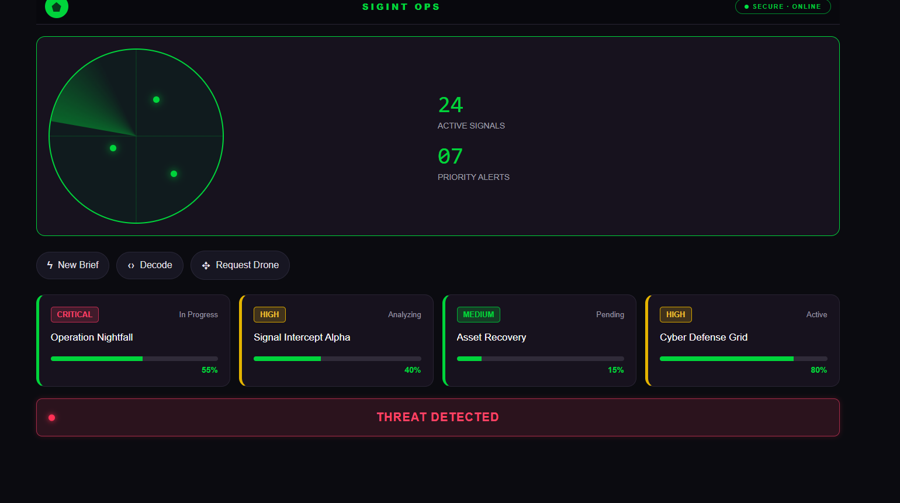

# 🛰️ INTEL COMMAND CENTER
### Intelligence. Analysis. Situational Awareness.

<p align="center">
  <strong>A modern intelligence dashboard built with pure HTML5 and CSS3.</strong>
</p>

<p align="center">
  
</p>

<p align="center">
  
  
  
  
</p>

---

## 📡 About the Project

**Intel Command Center** is a modern intelligence-management dashboard designed to present intelligence reports, operational information, and system status in a clear, organized, and professional interface.

Inspired by intelligence command centers, the project combines a dark visual theme, structured layouts, and carefully designed interface elements to create an immersive operational experience.

Built entirely with **HTML and CSS**, the project demonstrates how semantic markup and advanced styling can create a polished dashboard without JavaScript.

## 🖥️ Project Preview

<p align="center">
  
</p>

<p align="center">
  <em>Dashboard overview — replace this image with a screenshot of the actual project.</em>
</p>

## 🎬 Demo Video

**See the interface in action.**

<p align="center">
  <a href="demo.mp4">
    
  </a>
</p>

<p align="center">
  ▶️ <a href="demo.mp4"><strong>Watch the Demo Video</strong></a>
</p>

> Replace the demo link with your actual video URL or video file path.

## ✨ Key Features

- **Intelligence Dashboard** — A centralized overview of intelligence activity.
- **Intelligence Reports** — Structured report cards for presenting important information.
- **Activity Overview** — A visual summary of received intelligence reports.
- **System Status** — Dedicated interface elements for displaying operational status.
- **Modern Dark Interface** — A high-contrast design inspired by professional command systems.
- **Interactive Visual Effects** — CSS transitions, hover effects, and animations that enhance the user experience.
- **Organized Navigation** — Clear navigation elements for accessing different dashboard sections.
- **Responsive Layout** — Layout adjustments for different screen sizes, where implemented.

## 🛠️ Technologies

| Technology | Purpose |
|---|---|
| HTML5 | Semantic structure and content |
| CSS3 | Styling, layouts, animations, and visual effects |
| Flexbox | Flexible alignment and component positioning |
| CSS Grid | Structured dashboard layouts |
| CSS Pseudo-classes | Hover, focus, and active states |
| CSS Transitions & Animations | Smooth visual interactions |
| Responsive CSS | Adaptation to different viewport sizes |

## 🎨 Design Highlights

The interface focuses on clarity, hierarchy, and a professional intelligence-inspired aesthetic.

- Dark command-center visual language.
- Clear separation between dashboard sections.
- Consistent spacing and typography.
- High-contrast status indicators.
- Carefully styled report cards and navigation.
- CSS-based visual effects and animations.

## 📂 Project Structure

```text
Intel-Command-Center/
│
├── index.html
├── styles.css
├── icones/
│   ├── activity.svg
│   ├── radio.svg
│   └── file-text.svg
│
├── assets/
│   ├── screenshot.png
│   ├── logo.png
│   └── demo.mp4
│
└── README.md
```

*Adjust the file and folder names above to match your actual project structure.*

## 🚀 Getting Started

No installation or build tools are required.

1. Clone or download the repository.
2. Open the project folder in Visual Studio Code.
3. Open `index.html` in your browser, or use the Live Server extension.
4. Explore the dashboard interface.

## 🎯 Project Goals

This project was created to practice and demonstrate:

- Writing clean, semantic HTML.
- Building complex layouts using Flexbox and CSS Grid.
- Applying CSS selectors and pseudo-classes.
- Creating animations and transitions.
- Developing a consistent visual design.
- Organizing a front-end project using Git and GitHub.

## 🔮 Future Improvements

- Additional dashboard sections and report categories.
- More responsive refinements.
- Expanded visual status indicators.
- Further CSS animation and interaction enhancements.

## 👩‍💻 Author

**Esther Peretz**

Front-End Development | HTML5 | CSS3

---

<p align="center">
  <strong>INTEL COMMAND CENTER</strong><br>
  <em>Turning information into a clear operational picture.</em>
</p>
